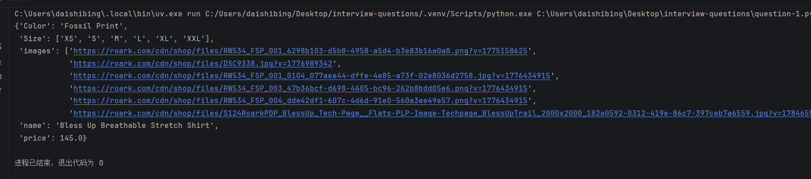
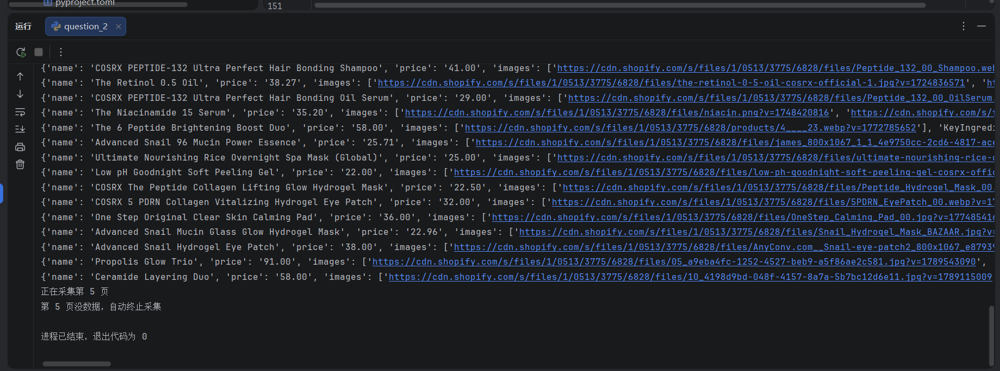
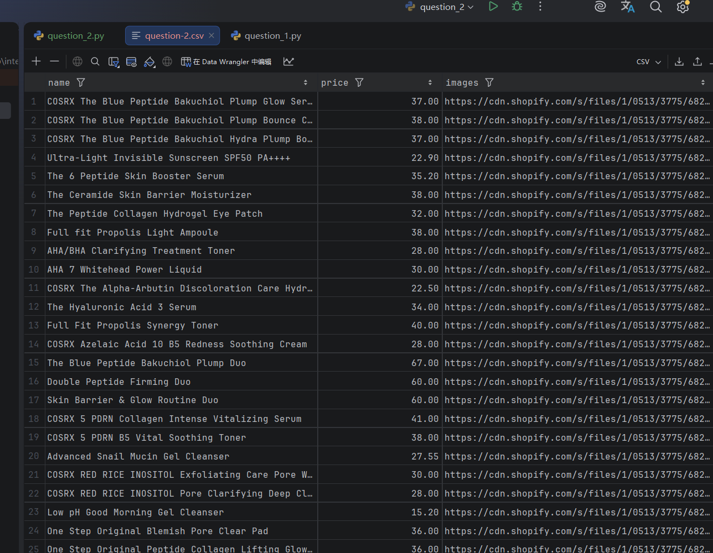
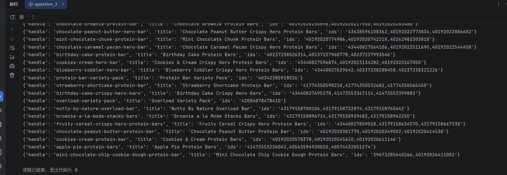
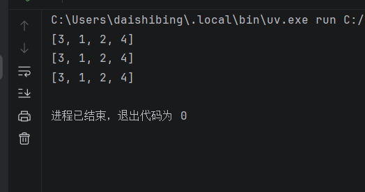
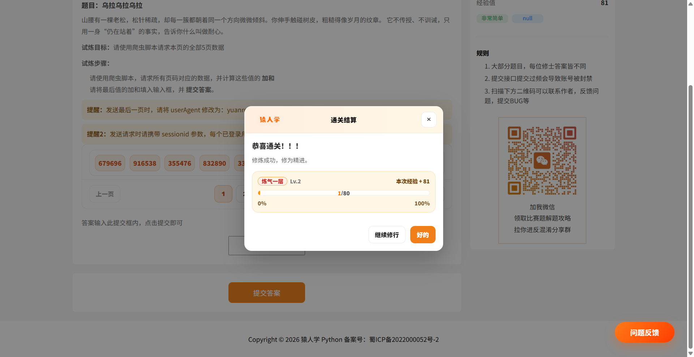

# interview-questions

基于 uv 管理的项目

## 运行项目

### 安装 uv

macOS 和 Linux：

```shell
curl -LsSf https://astral.sh/uv/install.sh | sh
```

Windows：

```shell
powershell -ExecutionPolicy ByPass -c "irm https://astral.sh/uv/install.ps1 | iex"
```

### 同步项目环境

```shell
uv sync
```

### 运行指定文件

```shell
uv run ./question_1.py
```

## 项目结果图

第一题：
<p align="center">
    
</p>

第二题：
<p align="center">
    
    
</p>

第三题：
<p align="center">
    
    
</p>

第四题：
<p align="center">
    
</p>

第五题：
<p align="center">
    
</p>
